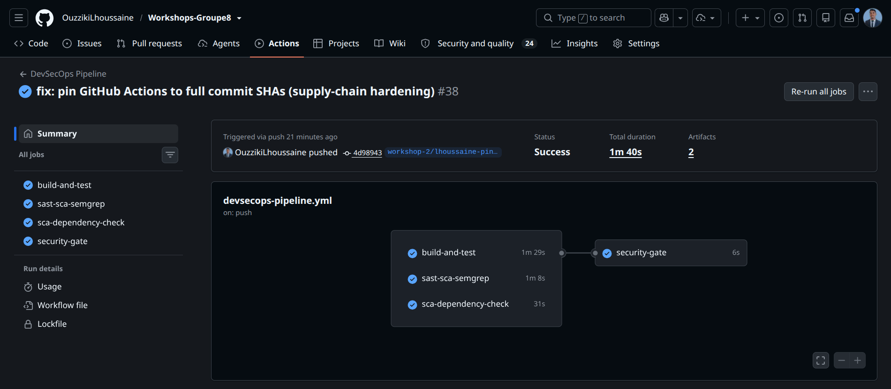
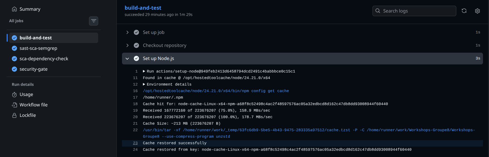
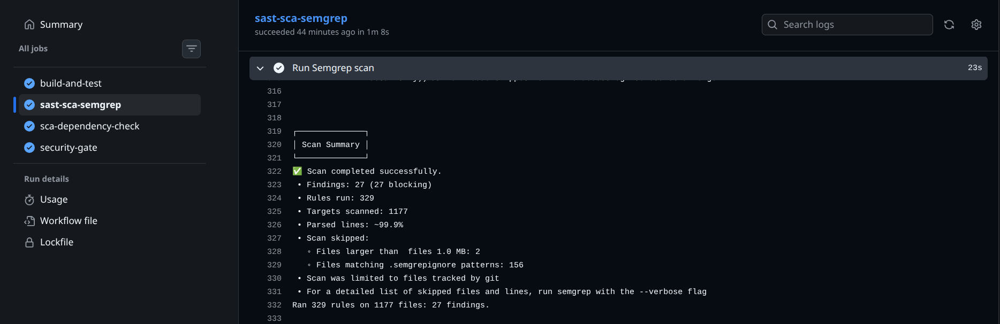
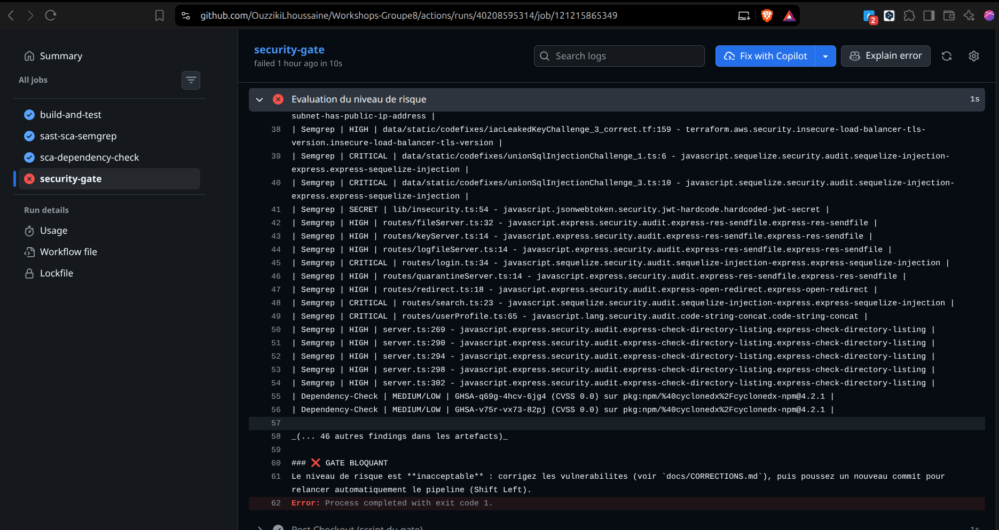
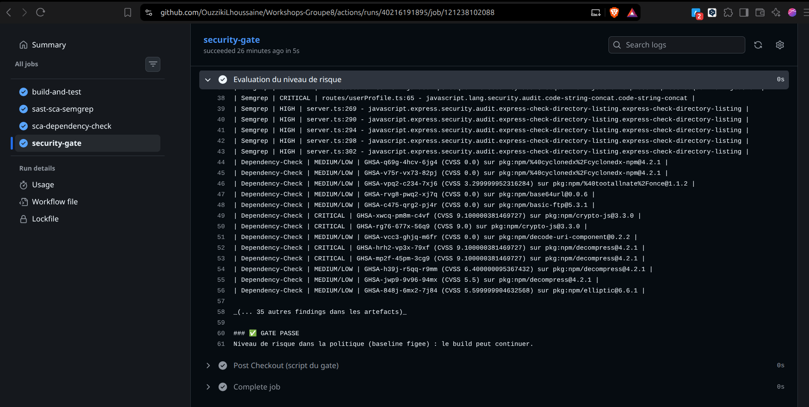
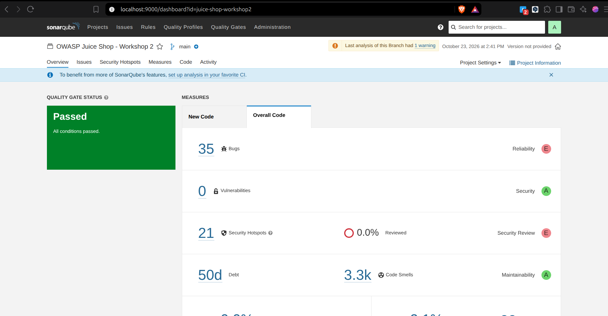

# Workshop 2 — Analyse SAST avec SonarQube et Semgrep

**OWASP Juice Shop — Groupe 8.** Équipe : Ouzziki Lhoussaine (rôles A, B et C), Zineb Hajaj et Hasna Elhassani (revue des pull requests).

> Ce rapport correspond à la carte « Analyse SAST avec SonarQube et Semgrep ». La partie SCA (Dependabot et OWASP Dependency-Check) est traitée sur la branche `workshop3`. Le rapport complet des deux parties se trouve sur la branche par défaut `workshop-2-sast-sca`.

## 1. Objectif

Travailler sur un projet contenant des vulnérabilités intentionnelles (injections, XSS, mauvaises pratiques) : configurer une analyse SAST avec SonarQube via Docker, l'intégrer dans un pipeline CI, utiliser Semgrep pour détecter des motifs de sécurité plus fins, comparer les résultats des deux outils, et corriger les vulnérabilités trouvées dans la mesure du possible.

## 2. Équipe et rôles

| Personne | Rôle |
|---|---|
| Ouzziki Lhoussaine | Rôle A (Semgrep, SonarQube) + Rôle B (Dependency-Check, Dependabot) + Rôle C (pipeline, security gate, rapport) |
| Zineb Hajaj | Collaboratrice : revue des pull requests |
| Hasna Elhassani | Collaboratrice : revue des pull requests |

## 3. Pipeline CI

Fichier `.github/workflows/devsecops-pipeline.yml` — actions épinglées par empreinte SHA, jobs 1 et 2 au cœur de cet atelier :

| Job | Rôle | Lien avec l'atelier |
|---|---|---|
| 1. `build-and-test` | Installation via lockfiles, compilation TypeScript (zéro erreur) | Prérequis : un projet qui compile |
| 2. `sast-sca-semgrep` | Scan Semgrep, rapport `semgrep-results.json` + SARIF | Cœur de l'atelier SAST |
| 3. `sca-dependency-check` | OWASP Dependency-Check (base NVD en cache) | Atelier 3 (branche `workshop3`) |
| 4. `security-gate` | Lecture des rapports, décision vert ou rouge | Intégration CI/CD commune |

Un rapport manquant bloque toujours le build. Le gate (`scripts/security_gate.py`) utilise une baseline figée : CRITICAL max 12, HIGH max 28, secrets max 1.

## 4. SonarQube (Docker, Community 9.9.8)

Projet `juice-shop-workshop2`, sonar-scanner 8.1, analyse réussie. Tableau de bord : `http://localhost:9000/dashboard?id=juice-shop-workshop2`.

| Mesure | Valeur |
|---|---|
| Lignes de code (ncloc) | 32588 |
| Bugs | 35 |
| Vulnérabilités | 0 |
| Code Smells | 3274 |
| Security Hotspots | 21 |

Vocabulaire : un bug est un défaut de fiabilité ; un code smell est une dette de qualité ; un security hotspot est un endroit sensible à relire.

## 5. Semgrep

Pack de règles `p/owasp-top-ten` (180 règles). Résultat : 27 constats.

| Famille | Gravité | Ce que ça veut dire |
|---|---|---|
| sequelize-injection (x6) | ERROR | Données utilisateur injectables dans une requête de base de données |
| code-string-concat (x1) | ERROR | Code construit par concaténation, risque d'exécution de code |
| directory-listing (x5) | WARNING | Un dossier du serveur peut lister ses fichiers publiquement |
| res-sendfile (x4) | WARNING | Envoi de fichiers insuffisamment filtré |
| insecure-load-balancer-tls-version (x3) | WARNING | Extraits Terraform pédagogiques avec TLS faible |
| open-redirect (x1) | WARNING | Redirection possible vers une adresse malveillante |
| jwt-hardcode (x1) | SECRET | Clé JWT écrite en dur dans le code |
| dependabot-missing-cooldown (x3) | MEDIUM | Informationnel : configuration Dependabot perfectible |
| github-actions-mutable-action-tag | — | 0 — corrigé par épinglage SHA |

Évolution : 30 constats au départ, 24 après les corrections, 27 aujourd'hui (les règles Semgrep s'enrichissent avec le temps).

## 6. Comparaison des deux outils

| Critère | Semgrep | SonarQube |
|---|---|---|
| Approche | correspondance de motifs (règles OWASP) | analyseur sémantique et modèle de qualité |
| Périmètre | TypeScript, Terraform, configuration npm | sources TypeScript filtrées |
| Total des constats | 27 | 3330 (35 bugs + 0 vulnérabilité + 3274 code smells + 21 hotspots) |
| Points forts | rapide, règles OWASP, secrets, IaC | qualité + sécurité, dashboard, hotspots |
| Limites | faux positifs, pas d'analyse de flux | peu de règles de vulnérabilité en édition Community |

Pourquoi les comptes diffèrent : objectifs différents, périmètres différents, règles maintenues indépendamment, complémentarité. Aucun outil ne voit tout : on additionne les résultats puis on arbitre.

## 7. Corrections apportées

Détail dans `docs/CORRECTIONS.md`. Corrections du groupe A (infra et configuration) : `map_public_ip_on_launch = false` (x2), redirection HTTP vers HTTPS 301 (x2), `min-release-age = 7` (x2), épinglage SHA des actions GitHub. Non corrigé volontairement : le code de challenge (failles voulues), les extraits pédagogiques `codefixes/`, le secret JWT en dur.

## 8. Captures d'écran

### 01 — les 4 jobs du pipeline, tous verts

### 02 — job build-and-test : compilation sans erreur

### 03 — constats Semgrep dans la CI

### 05 — security gate bloquant (GATE BLOQUANT)

### 06 — security gate vert après corrections (GATE PASSE)

### 07 — tableau de bord SonarQube

## 9. Pour la suite

- Partie SCA (Dependabot et OWASP Dependency-Check) : branche `workshop3`.
- Rapport complet des deux ateliers, incidents et guide de reproduction : branche par défaut `workshop-2-sast-sca` (`docs/GUIDE-workshop-2.md`, `docs/CORRECTIONS.md`).
