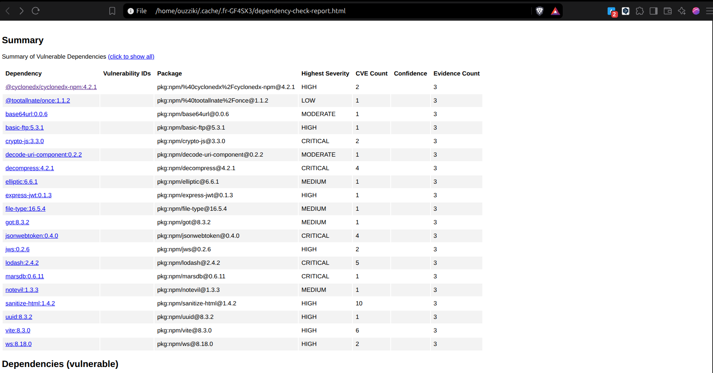
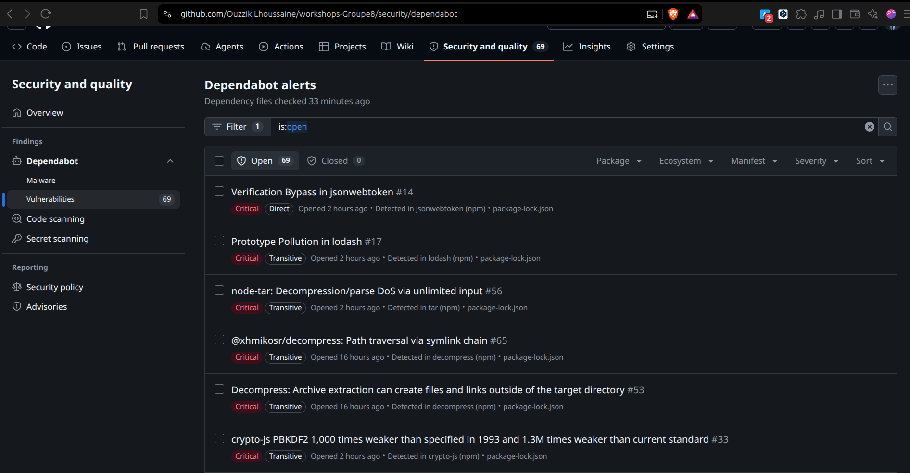
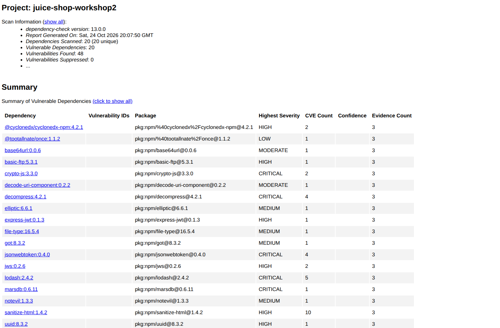

# Workshop 3 — Dependabot et OWASP Dependency-Check

**OWASP Juice Shop — Groupe 8.** Réalisé par Ouzziki Lhoussaine.

> Ce rapport correspond à la carte « Dependabot et OWASP Dependency-Check ». La partie SAST (SonarQube et Semgrep) est traitée sur la branche `workshop2`. Le rapport complet des deux parties se trouve sur la branche par défaut `workshop-2-sast-sca`.

## 1. Objectif

Sécuriser les dépendances d'un projet : configurer Dependabot pour générer automatiquement des pull requests de mise à jour, utiliser OWASP Dependency-Check pour détecter les vulnérabilités des bibliothèques, intégrer le tout dans un pipeline CI/CD, et corriger efficacement les vulnérabilités détectées dans la mesure du possible.

## 2. Rôles

Ce workshop a été réalisé en entier par Ouzziki Lhoussaine, qui a tenu les trois rôles :

| Rôle | Contenu |
|---|---|
| Rôle A | Analyse SAST : Semgrep et SonarQube |
| Rôle B | Analyse SCA : OWASP Dependency-Check et Dependabot |
| Rôle C | Pipeline CI, security gate et rapport |

## 3. Pipeline CI/CD

Fichier `.github/workflows/devsecops-pipeline.yml` — actions épinglées par empreinte SHA, jobs 3 et 4 au cœur de cet atelier :

| Job | Rôle | Lien avec l'atelier |
|---|---|---|
| 1. `build-and-test` | Compilation TypeScript (zéro erreur) | Base commune |
| 2. `sast-sca-semgrep` | Scan SAST (Semgrep) | Atelier 2 (branche `workshop2`) |
| 3. `sca-dependency-check` | OWASP Dependency-Check, base NVD mise en cache | Cœur de l'atelier SCA |
| 4. `security-gate` | Lecture des rapports, décision vert ou rouge | Intégration CI/CD commune |

Points techniques : base NVD en cache GitHub (clés `dependency-check-nvd2-*`), clé API NVD via secret `NVD_API_KEY` (jamais dans le code), archives d'attaque de `test/files/` exclues du scan (zip chiffrés et zip-slip qui font échouer l'extraction), `mkdir -p reports .dc-data` avant le conteneur Docker (sinon échec de verrou de la base H2).

## 4. npm audit (vision rapide)

Dépôt racine : 26 vulnérabilités (13 faibles, 3 modérées, 10 élevées). Frontend : 20 vulnérabilités (13 faibles, 5 modérées, 2 élevées). `npm audit fix` n'a volontairement pas été appliqué : il corrigerait les vulnérabilités volontaires du projet cible.

## 5. OWASP Dependency-Check (contrôle approfondi)

Comparaison des deux lockfiles à la NVD (base mondiale des failles, tenue par le NIST). Rapports HTML et JSON conservés comme artefacts (`dependency-check-report`).

| Gravité | Occurrences |
|---|---|
| CRITICAL (CVSS 9 à 10) | 5 |
| HIGH (CVSS 7 à 8,9) | 8 |
| MEDIUM/LOW (CVSS inférieur à 7) | 35 |
| Total | 48 |

Une même bibliothèque présente dans les deux lockfiles est comptée dans chaque zone : 48 occurrences ne signifient pas 48 failles distinctes.

## 6. Dependabot

Configuration `.github/dependabot.yml` : npm (racine), npm (frontend), github-actions — mises à jour hebdomadaires. Alertes de sécurité (onglet Security) : 69 alertes ouvertes (capture 08).

Politique de groupe : les pull requests Dependabot servent de preuve de détection mais ne sont JAMAIS fusionnées. Elles corrigeraient les vulnérabilités volontaires du projet cible et fausseraient les résultats SCA. Incident documenté : les PR #10 et #11 ont été fusionnées par erreur le 25/10 puis annulées (PR #13, `git revert`), avec ajout de `legacy-peer-deps=true` dans `frontend/.npmrc` comme protection.

## 7. Corrections apportées (chaîne d'approvisionnement)

Détail dans `docs/CORRECTIONS.md` : `min-release-age = 7` dans les deux `.npmrc` (attendre 7 jours avant d'utiliser une nouvelle version de paquet npm, protection contre les versions piégées), `package-lock=true`, verrou `legacy-peer-deps=true`, épinglage SHA des actions GitHub, annulation des fusions Dependabot accidentelles.

## 8. Security gate (intégration CI/CD)

`scripts/security_gate.py` lit les rapports SAST et SCA et termine le build avec le code 0 (vert) ou 1 (bloqué). Un rapport manquant ou illisible = gate bloquant. Seuils « baseline figée » : CRITICAL max 12, HIGH max 28, secrets max 1 — mesurés une fois, jamais assouplis.

## 9. Captures d'écran

### 01 — les 4 jobs du pipeline, tous verts

### 04 — CVE (GHSA/CVSS) du rapport Dependency-Check

### 05 — security gate bloquant (GATE BLOQUANT)

### 06 — security gate vert après corrections (GATE PASSE)

### 08 — alertes Dependabot (onglet Security)

### 09 — vue d'ensemble du rapport Dependency-Check

## 10. Pour la suite

- Partie SAST (SonarQube et Semgrep) : branche `workshop2`.
- Rapport complet des deux ateliers, incidents et guide de reproduction : branche par défaut `workshop-2-sast-sca` (`docs/GUIDE-workshop-2.md`, `docs/CORRECTIONS.md`).
